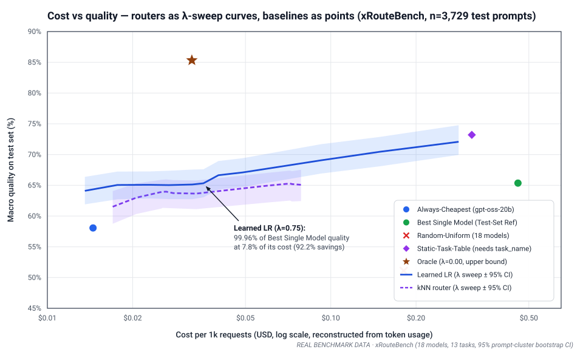

# LLM Cost Autopilot

**Built by Harshini A**

An adaptive, cost-aware LLM routing service and offline evaluation framework. It combines a FastAPI routing API (Groq & Google Gemini), per-request `Decimal` budget tracking, Supabase telemetry, a Streamlit dashboard, a Python SDK, and a leakage-safe empirical evaluation suite.

> Engineering prototype, not an absolute provider-billing cap. Reconstructed benchmark costs and estimates may differ from live provider invoices.

---

## Benchmark Results (M4 — xRouteBench)

Evaluated offline on **xRouteBench** (`ulab-ai/xRouteBench`, **3,729** held-out test prompts, **18** candidate LLMs, **13** tasks, zero live API calls; CC BY-NC-SA 4.0). Learned routers are swept over cost penalty $\lambda \in [0.00, 5.00]$ with **95% prompt-cluster bootstrap confidence intervals**; baselines are single operating points and the Oracle marks the theoretical ceiling.



| Strategy | Role | Macro Quality [95% CI] | Micro Quality [95% CI] | Cost / 1k Queries | Historical LLM Latency* |
| :--- | :--- | :---: | :---: | :---: | :---: |
| **Always-Cheapest** (`gpt-oss-20b`) | Deployable baseline | 0.5806 [0.5627, 0.5965] | 0.6976 [0.6810, 0.7113] | \$0.014 | 3.21s |
| **Random-Uniform** (18 models) | Deployable baseline | 0.5109 [0.4897, 0.5292] | 0.6173 [0.6004, 0.6343] | \$0.181 | 2.76s |
| **Static-Task-Table** | Deployable (needs `task_name`) | 0.7321 [0.7041, 0.7570] | 0.8137 [0.8020, 0.8258] | \$0.315 | 3.15s |
| **kNN ($\lambda = 0.10$)** | Deployable learned router | 0.6529 [0.6251, 0.6739] | 0.7115 [0.6956, 0.7246] | \$0.072 | 2.95s |
| **Learned LR ($\lambda = 0.75$)** | Deployable (quality parity) | **0.6533** [0.6305, 0.6761] | 0.7380 [0.7234, 0.7518] | **\$0.036** | 3.22s |
| **Learned LR ($\lambda = 0.00$)** | Deployable (max quality) | **0.7208** [0.6994, 0.7478] | 0.7994 [0.7848, 0.8121] | \$0.283 | 3.44s |
| **Best Single Model** (`qwen3-next-80b-a3b-instruct`) | Post-hoc test reference | 0.6536 [0.6368, 0.6650] | 0.8054 [0.7931, 0.8188] | \$0.458 | 2.52s |
| **Oracle ($\lambda = 0.00$)** | Theoretical upper bound | 0.8533 [0.8325, 0.8760] | 0.9293 [0.9218, 0.9377] | \$0.032 | 2.64s |

\* *Historical LLM Latency is the downstream provider response time recorded in xRouteBench, distinct from local router CPU overhead (<1 ms).*

- **Full Research Report:** [`reports/m4/M4_FINAL_RESEARCH_REPORT.md`](reports/m4/M4_FINAL_RESEARCH_REPORT.md)

---

## Milestones

- **M1 — Benchmark & Evaluation Infrastructure:** Unified LiteLLM execution harness (`eval/runner.py`), deterministic task evaluators (`eval/metrics.py`), read-only integrity checks (`eval/integrity.py`), and provenance-verified dataset adapters (`eval/dataset_registry.py`, `eval/external_datasets.py`).
- **M2 — Baseline Evaluation:** Leakage-safe prompt-level partitioning and five reference baselines (`Always-Cheapest`, `Static-Task-Table`, `Random-Uniform`, `Best Single Model`, `Oracle`) implemented in `eval/baselines.py`.
- **M3 — Learned Cost-Aware Routers:** Pre-inference MiniLM embeddings (`eval/routers/encoders.py`), distance-weighted `kNN` (`eval/routers/knn_router.py`), L2-regularized Logistic Regression (`eval/routers/learned_router.py`), utility engine $U(m,x) = \hat{Q}(m,x) - \lambda c_{\text{norm}}(m,x)$ (`eval/routers/decision.py`), and operational robustness stress-testing (`eval/router_robustness.py`).
- **M4 — Rigorous Offline Evaluation (xRouteBench):**
  - **Multi-Model Routing:** `Learned LR` ($\lambda=0.75$) matches `Best Single Model` quality at **92.2% lower cost** (\$0.036 vs. \$0.458/1k), and at $\lambda=0.00$ gains **+0.0672 Macro Quality** at **38.3% lower cost**.
  - **Calibration:** `Learned LR` achieves **0.0389 raw ECE** (**0.0283** after out-of-fold Platt scaling) with negligible downstream ranking drift; `kNN` improves from **0.1123** to **0.0490 ECE** via isotonic regression.
  - **OOD Generalization:** Leave-one-task-out across 6 unseen tasks yields a 3–3 split (`LR` leads on `gsm8k`, `mmlu`, `aime_2020_2024`; `kNN` leads on `mbpp`, `human_eval`, `squad`), with calibration degrading sharply on novel task shifts.
  - **Two-Model APGR (RouteLLM-Inspired):** On `cogito-v2-1-671b` vs. `llama-3-8b-instruct-lite`, Hybrid Ensemble achieves **0.5906** Micro APGR `[0.5761, 0.6058]` (**0.5904** Macro APGR, null-centered bootstrap $p = 1/1001 \approx 0.000999$, rounded to `0.0010` vs. 0.50 random boundary; overlapping CIs with `kNN` `0.5818` and `LR` `0.5810` do not establish between-router superiority).
- **M5 — Production Serving & Runtime Routing:**
  - Unified `RuntimeRouter.route(prompt, lam) -> RouteDecision` adapters (`routers/knn_runtime.py`, `routers/lr_runtime.py`) using cached local MiniLM weights.
  - OpenAI-compatible `POST /v1/chat/completions` (`auto`, `auto:quality`, `auto:balanced`, `auto:cheap`, or explicit live model) with ranked fallback, `BudgetTracker` enforcement, SQLite decision logging (`telemetry/decision_log.py`), `POST /v1/feedback`, and leakage-safe retraining/shadow-eval/atomic promotion (`routers/lifecycle.py`, `docs/adding-a-model.md`).
  - **M5 Serving Report:** [`reports/m5/M5_SERVING_REPORT.md`](reports/m5/M5_SERVING_REPORT.md)

---

## M5 Serving & OpenAI-Compatible API

### Lambda Presets

| `model` Value | $\lambda$ | Behavior | Empirical Basis |
| :--- | :---: | :--- | :--- |
| `auto` / `auto:balanced` | `0.5` | Balanced quality-cost tradeoff | M4.2 xRouteBench (`0.6664` Macro, `\$0.040/1k`); provisional for live pool |
| `auto:quality` | `0.0` | Quality-focused (zero cost penalty) | M4.2 xRouteBench (`0.7208` Macro, `\$0.283/1k`) |
| `auto:cheap` | `2.0` | Cost-focused | M4.2 xRouteBench (`0.6508` Macro, `\$0.023/1k`); provisional for live pool |

### Example `POST /v1/chat/completions` Request & Response

```json
// Request
{
  "model": "auto:balanced",
  "messages": [{"role": "user", "content": "Explain binary search in Python."}],
  "max_tokens": 512,
  "temperature": 0.7
}
```

```json
// Response (OpenAI-compatible + routing metadata)
{
  "id": "chatcmpl-...",
  "object": "chat.completion",
  "model": "openai/gpt-oss-20b",
  "choices": [{"index": 0, "message": {"role": "assistant", "content": "..."}, "finish_reason": "stop"}],
  "usage": {"prompt_tokens": 12, "completion_tokens": 84, "total_tokens": 96},
  "routing": {
    "chosen_model": "openai/gpt-oss-20b",
    "predicted_scores": {"openai/gpt-oss-20b": 0.84, "openai/gpt-oss-120b": 0.91},
    "ranked_candidates": ["openai/gpt-oss-20b", "openai/gpt-oss-120b", "gemini-2.5-flash"],
    "router_version": "lr-v1",
    "lambda": 0.5,
    "expected_cost_usd": 0.000015,
    "actual_cost_usd": 0.000026,
    "budget_accounted_cost_usd": 0.000026,
    "input_tokens": 12,
    "output_tokens": 84,
    "latency_ms": 142.5,
    "router_latency_ms": 18.2,
    "fallback_attempts": [],
    "quality_status": "unverified"
  }
}
```

- **Ranked Fallback:** On timeout, rate limit, or provider error, `serving/chat_completions.py` iterates through `ranked_candidates` in `model_registry.MODELS`, enforcing `BudgetTracker` per attempt without double-counting failures and reporting every failed attempt in `routing.fallback_attempts`.
- **Feedback & Lifecycle:** `POST /v1/feedback` logs `judge_score`, `user_feedback`, or `downstream_task_success` to SQLite (`prompt_hash` only; raw prompts are not stored by default). `routers/lifecycle.py` handles leakage-checked retraining, `shadow_evaluate`, fail-closed `promote_router`, and `rollback()`. See [`docs/adding-a-model.md`](docs/adding-a-model.md).

## Architecture & Routing Modes

```text
Python SDK / Query Console ──▶ FastAPI (/query) ──▶ Classifier + Candidate Filter + Mode Ranker
                                                            │
Supabase Telemetry ◀── Judge / Escalation ◀── Groq / Gemini ◀── Decimal Budget Tracker
```

- **Modes:** `balanced` (default: 50% quality, 35% cost, 15% latency), `economy`, `quality`, and `latency` after filtering by availability, context window, quality floor, and per-request `max_cost_usd`.

---

## Quickstart & Offline Verification

### Run the Service Locally

```powershell
python -m venv .venv
.\.venv\Scripts\Activate.ps1
python -m pip install -e .
```

Configure `.env` (`GROQ_API_KEY`, `GEMINI_API_KEY`, `SUPABASE_URL`, `SUPABASE_KEY`, `LLM_AUTOPILOT_API_KEY`), apply [`migrations/001_hard_budget_enforcement.sql`](migrations/001_hard_budget_enforcement.sql), and start:

```powershell
uvicorn main:app --reload --port 8000
streamlit run query_console.py --server.port 8501
streamlit run dashboard.py --server.port 8502
```

### Offline M4/M5 Reproduction & Tests (Zero API Calls)

```powershell
$env:PYTHONPATH="."
.venv\Scripts\python -m eval.m4_router_evaluation
.venv\Scripts\python -m eval.m4_calibration
.venv\Scripts\python -m eval.m4_ood_evaluation
.venv\Scripts\python -m eval.m4_routellm_baseline
.venv\Scripts\python scripts/demo_m5.py --lam auto:balanced --prompts 50
.venv\Scripts\pytest tests_v2/test_m5_serving.py -v
.venv\Scripts\pytest tests_v2 -v
```

---

## Project Layout

```text
main.py / routing_policy.py / budget.py   FastAPI (/query, /v1/chat/completions, /v1/feedback) & Decimal budget tracker
routers/                                  M5 RuntimeRouter adapters (kNN, LR), registry, retraining, shadow eval, promotion
serving/                                  OpenAI-compatible handler & ranked fallback execution
telemetry/                                SQLite decision logger & outcome feedback store
providers/ / llm_cost_autopilot_client/   Groq & Gemini adapters, Python SDK
dashboard.py / query_console.py           Streamlit telemetry dashboard & query UI
eval/                                     M1–M4 benchmark, baseline, router, calibration & OOD modules
scripts/demo_m5.py                        50-prompt offline replay demonstration
docs/adding-a-model.md                    Cold-start model onboarding procedure
reports/m4/ & reports/m5/                 M4 & M5 research/serving reports, CSV/JSON results & SVG plots
tests_v2/                                 Offline unit & integration test suite (M0–M5)
```

## Limitations

- Budget limits are per-request, not shared global/monthly quotas; provider invoices may differ from estimates.
- The live `model_registry.py` pool (`openai/gpt-oss-20b`, `openai/gpt-oss-120b`, `gemini-2.5-flash`) lacks a genuine held-out calibration dataset; `/v1/chat/completions` with `model="auto*"` returns HTTP `503` until a calibrated router bundle is trained and promoted.
- `ulab-ai/xRouteBench` is licensed under **CC BY-NC-SA 4.0** (noncommercial research/evaluation only).
- M4/M5 offline results do not demonstrate live production SLA readiness.
